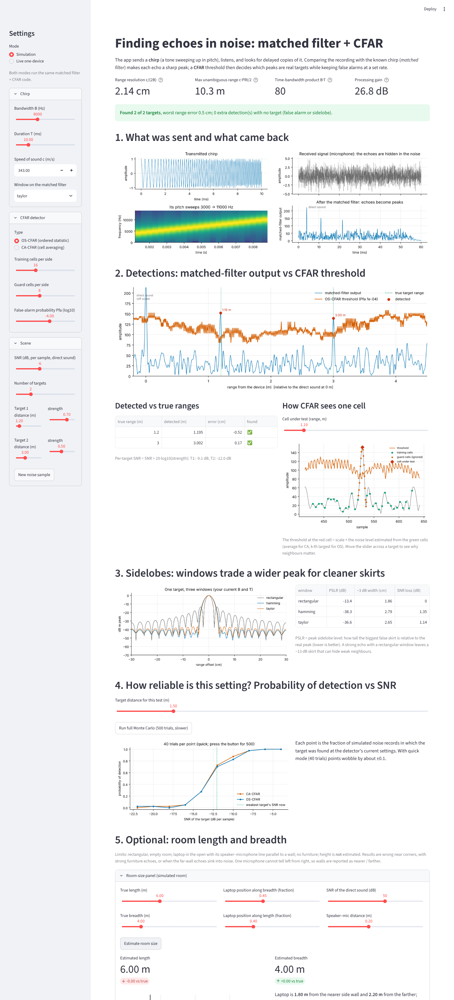

# Matched-Filter Chirp Ranging with CFAR Detection

Detect echoes by correlating the received signal with a known chirp (matched filter / pulse compression),
then separate real targets from noise with a CFAR (constant false-alarm-rate) threshold. One DSP code base
(`src/`, pure NumPy) drives two modes:

* **Simulation** - generate a chirp, add echoes at chosen distances, add noise, process.
* **Live one-device** - the laptop plays a chirp through its speaker and records with its microphone at the
  same time (`sounddevice`). The *direct* speaker-to-microphone sound is the zero-distance reference, so the
  unknown audio latency cancels. If no audio device exists the app says so and falls back to simulation.

An optional stage estimates the **length and breadth of a rectangular room** from the wall echoes.



## Install and run

```bash
python -m venv .venv && source .venv/bin/activate     # optional
pip install -r requirements.txt
pytest                                                # 32 tests, ~6 s
streamlit run app.py                                  # opens http://localhost:8501
bash experiments/run_all.sh                           # regenerates docs/figures and docs/tables
python experiments/build_report.py                    # report .docx   (docs/report.docx)
python experiments/build_ppt.py                       # slides .pptx   (docs/presentation.pptx)
```

`sounddevice` needs the PortAudio library (Linux: `sudo apt install libportaudio2`; Windows/macOS wheels include it).

## Repo layout

| path | content |
|---|---|
| `src/chirp.py` | LFM chirp, range resolution `c/(2B)`, unambiguous range `c*PRI/2`, delay<->range |
| `src/matched_filter.py` | FFT matched filter (time-reversed conjugate reference), window SNR loss |
| `src/windows.py` | rectangular / Hamming / Taylor |
| `src/cfar.py` | CA-CFAR and OS-CFAR thresholds and their closed-form scale factors |
| `src/pipeline.py` | `RadarConfig`, `process()` (filter -> CFAR -> peaks -> ranges, direct-path logic) |
| `src/simulation.py` | echo + noise generator |
| `src/metrics.py` | PSLR / main-lobe width, Monte Carlo Pd, false alarms, range error |
| `src/audio_io.py` | full-duplex play+record, device check, `AudioUnavailable` fallback |
| `src/room.py` | image-source room simulator (Allen-Berkley) and length/breadth estimator |
| `app.py` | Streamlit app |
| `experiments/` | scripts that produce every figure/table of the report, plus the report/PPT builders |
| `tests/` | pytest suite |
| `docs/` | `figures/`, `tables/`, `screenshots/`, report and slides |

## The algorithms in a few lines

**Chirp.** `s(t)=cos(2*pi*(f0*t + 0.5*(B/T)*t^2))`: pitch sweeps from `f0` to `f0+B` in `T` seconds.

**Matched filter.** The best linear detector for a known signal in white noise correlates the recording with
that signal. Correlation = convolution with the time-reversed (conjugated) reference, computed as
`IFFT( FFT(rx) * conj(FFT(ref)) )` with zero padding. Keeping only positive frequencies makes the output
*analytic*, so `abs()` is a smooth envelope. A long chirp (`B*T` large) is "compressed" into a peak about
`1/B` wide: range resolution `c/(2B)`, and the SNR rises by about `10*log10(T*fs)` dB.
Range from delay: `R = c*delay/2`; maximum unambiguous range `c*PRI/2` (PRI = listening window).

**Windows.** The ideal filter has -13 dB sidelobes (sinc shape) that can hide weak neighbours. Tapering
the reference (Hamming or Taylor) lowers them to about -37 dB at the price of a ~30 % wider main lobe and
~1.1-1.4 dB SNR loss. The app and `docs/tables/windows.csv` report PSLR (peak sidelobe level) for each.

**CA-CFAR (Rohling).** For every cell under test, average `N` training cells (skipping guard cells), multiply by
`alpha = N*(Pfa^(-1/N) - 1)`; the cell is a detection if its power exceeds that threshold. The false-alarm
rate stays constant when the noise level changes. Weakness: a strong neighbour in the training cells inflates
the average and **masks** a weaker target.

**OS-CFAR.** Same, but the noise estimate is the `k`-th smallest training value (`k = 0.75 N`), so up to `N-k`
strong cells are ignored. `alpha` solves `prod (N-i)/(N-i+alpha) = Pfa`. Costs a little sensitivity in
clean noise, handles close targets (see `docs/figures/fig5_masking.png`).

Practical detail: matched-filter samples are correlated (output is oversampled by `fs/B`), so training cells
are spaced `fs/B` samples apart (`RadarConfig.stride`), and guard cells (default 8) must cover the main lobe;
`docs/tables/guard_sweep.csv` shows what happens otherwise.

## Live mode

1. Put the laptop in the open, a hard flat surface (wall, large box) facing it, volume up. The chirp is audible.
2. The app plays one chirp at t=0 and records 0.4 s. The strongest peak is the direct sound (speaker -> mic,
   a few cm) and defines zero distance; every echo range is `c*(t_echo - t_direct)/2`, so audio latency cancels.
3. If that peak is not clearly above the noise the app warns: speaker/mic not working, volume too low or too
   much noise. If PortAudio or a device is missing, it says why and shows the simulation.
4. `python experiments/exp6_live.py --distance 1.00` repeats the run and writes `docs/tables/live_run.csv`
   (error vs a tape measure). **Without an audio device it writes a clearly marked placeholder, never made-up numbers.**

Physical limits: the direct sound plus any reflection from the laptop's own screen/chassis (a few cm away,
< one range cell for B = 8 kHz is ~2 cm) merge into the direct peak, so **targets closer than ~10-20 cm cannot be
separated from it**. Use a wall or box at 0.5-3 m. Laptop speakers/mics are band-limited and have uneven response,
so the achievable bandwidth in practice is lower than in simulation.

## Room length and breadth (optional stage)

The simulator places a laptop in a rectangular room with the image-source method; the estimator takes the
detected echoes (distance = (range after direct + speaker-mic distance)/2) and tries every way to call two
echoes the left/right walls and two the front/back walls. For each hypothesis it predicts *all* image-source
echoes up to order 3, including wall-to-wall echoes at `a+b`, and keeps the hypothesis that explains the most
detected echoes.

Limits (also shown in the app): rectangular empty room, laptop in the open with its speaker-mic line parallel to
a wall, no furniture, **no height estimate**, one microphone cannot tell left from right (walls are "nearer/farther"),
wrong results near corners, with strong furniture echoes, or when far-wall echoes are in the noise. Simulated
success rates are in `docs/tables/room_estimates.csv` (not 100 %). No real-room measurement was made.

## Tests

`pytest` covers: self-correlation peak, FFT filter == time-reversed convolution, delays within one sample,
resolution/unambiguous-range formulas, windows lowering PSLR, CA/OS false-alarm rates (theory and real matched-filter
noise), detection of a known target, rejection of pure noise, OS-CFAR beating CA-CFAR in the masking case,
fake-audio live chain (latency cancels), audio fallback, image-source agreement with pyroomacoustics, room estimates.
