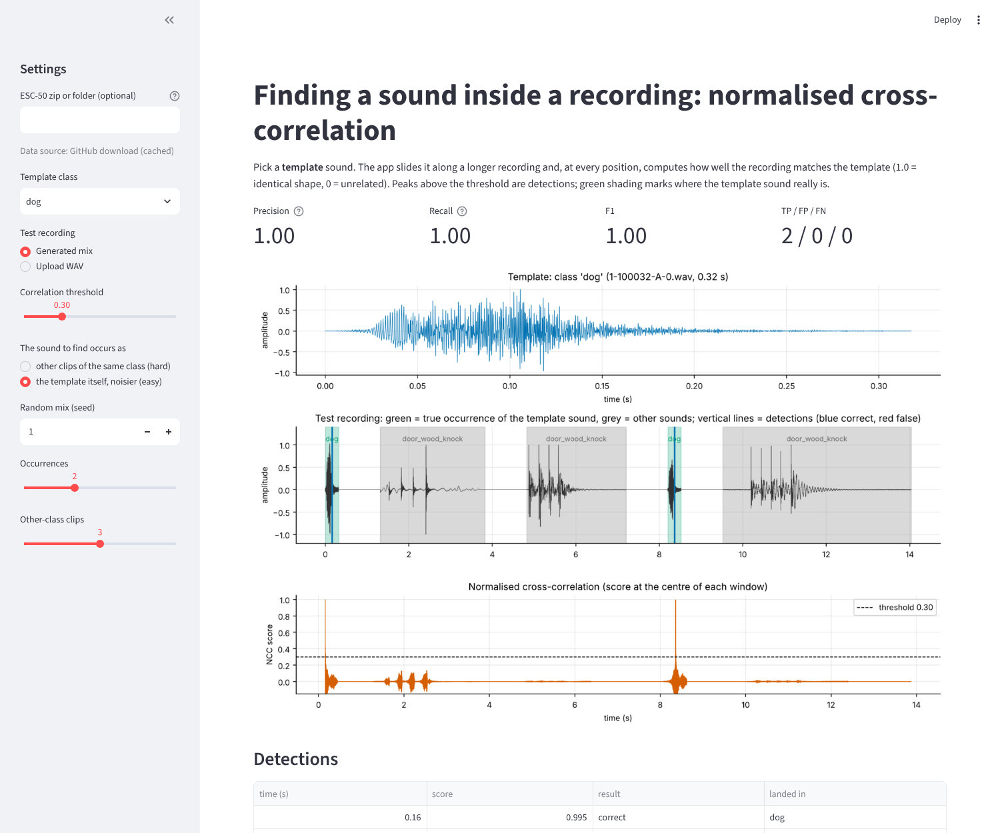

# Template matching of environmental sounds (ESC-50) with normalised cross-correlation

Pick one sound as a template; the app slides it along a longer recording, scores every position with
normalised cross-correlation (NCC), picks peaks above a threshold and scores them against known ground truth
(test recordings are built by joining ESC-50 clips, so every clip's start and end are known).



## Get the data (use the zip you already downloaded)
Nothing needs extracting or copying into the code. Choose **one**:

1. **Environment variable** (best): point to the zip (or an extracted folder) before running.
   * PowerShell: `$env:ESC50_PATH = "C:\Users\<you>\Downloads\ESC-50-master.zip"`
   * Git Bash: `export ESC50_PATH="/c/Users/<you>/Downloads/ESC-50-master.zip"`
2. **Paste the path** into the "ESC-50 zip or folder" box in the app's sidebar.
3. **Drop the zip into `data/`** in this folder (it is git-ignored, so the 600 MB is never committed).
4. Do nothing: the loader downloads only the clips it needs (the 5 chosen classes, about 90 MB) from GitHub into `data/cache/`.

Only `meta/esc50.csv` and the WAVs of the chosen classes are read, straight out of the zip. Class names come from the CSV
(the knock class is spelled `door_wood_knock`). Licence: CC BY-NC 3.0 - cite Piczak (2015).

## Run
```bash
pip install -r requirements.txt
pytest                     # 6 tests
streamlit run app.py
python experiments/exp_threshold.py     # P/R/F1 vs threshold -> docs/figures, docs/tables
python experiments/build_report.py && python experiments/build_ppt.py
```

## Files
`src/dataset.py` (zip/folder/GitHub reader, resample to 16 kHz, trim padding) · `src/matching.py` (FFT NCC, peak picking) ·
`src/recording.py` (joins clips, ground-truth spans) · `src/metrics.py` (centre-in-span scoring, P/R/F1) · `app.py` ·
`experiments/` · `tests/` · `docs/` (report, slides, figures, tables).

## What the results say
See `docs/tables/best_threshold.csv`. A template repeated in the recording is found perfectly (F1 1.00), but *different*
clips of the same class are not reliably found by raw-waveform NCC: only dog and door_wood_knock beat the chance baseline.
